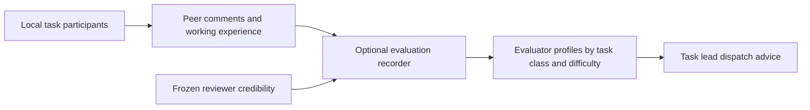
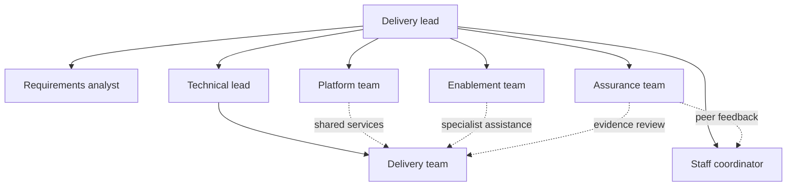
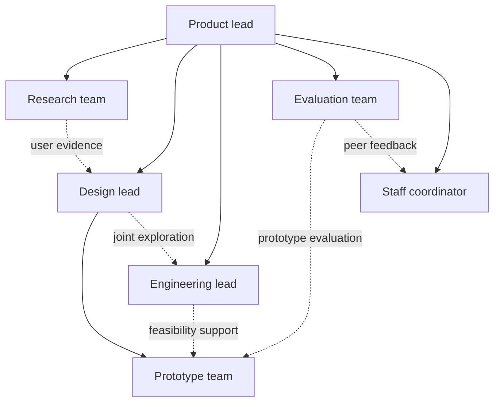
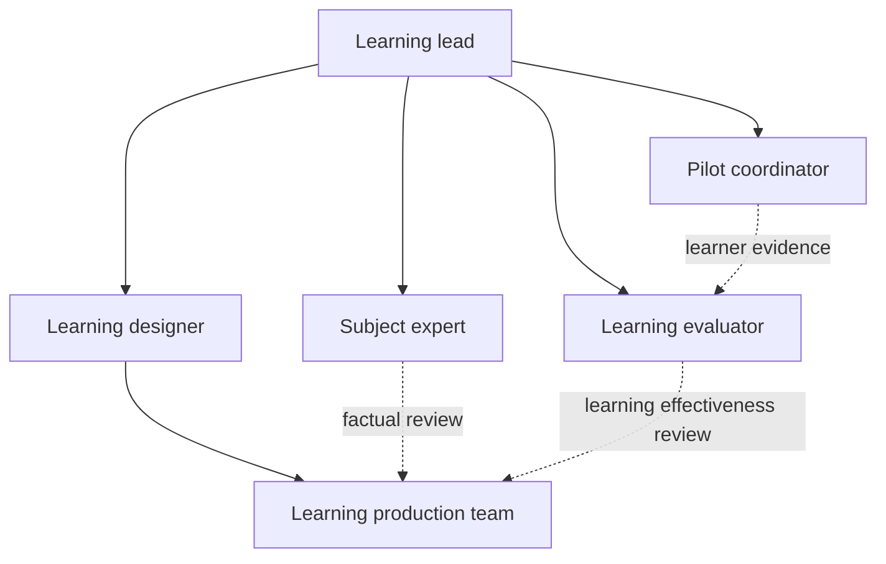

# Hakengaisya

Hakengaisya is an experimental technical-agent suite with explicit reporting lines, delegated work and upward acceptance. It derives a task-sized organization from real deliverables and dependencies, then matches adequate workers by contextual ability, cost and useful parallelism. The workflow and employee evaluator can each be used independently.

**Development stage: 0.8.x preset completion.** See [ROADMAP.md](ROADMAP.md) for current work, preset/scale coverage gaps and completion criteria. The project stays on 0.8.x until the main researched workflow presets are complete; 0.9 is reserved for real-task testing/optimization, and 1.0 follows successful validation.

Version 0.8.6 moves the whole suite except the browser leaderboard to strict TypeScript. Node 24 runs the `.ts` sources directly, so both plugins still need no build step; `npm run typecheck` checks the suite and the evaluator. The type checker exposed latent crashes on malformed input (a supervised review without an assignment, a federation project without clients, teams or contracts, a missing planned route), which now fail with validation errors instead. The planner gains an opt-in trial policy for the cold start: with `planning_limits.unproven_routes: "trial"` and an explicit `trial_estimate`, routine and standard work that has no qualifying observation can still be planned on a labelled trial route instead of turning the whole plan into needs-evidence. The run journal was measured rather than compacted: a 300-item run with 1200 events persists as 1.3 MB and one locked update takes about 7 ms, so the full audit trail stays.

Version 0.8.5 restructures the controller for maintainability and speed without changing its contracts. Events copy only the packets they touch, so a 300-item lifecycle drops from about 4.3 s to 70 ms of controller time; the planner validates and scores routes once instead of once per pool size. Assignment write scopes now use the same normalization as planned work, reference templates declare their independent audits with `audits`, cost estimates are rounded to whole nano-dollars, and the plugin runtime file list is derived in one place for the build and the release audit. Development uses [Biome](https://biomejs.dev) for formatting and linting (`npm run format`, `npm run lint`); it is the only development dependency and is not shipped in either plugin.

Version 0.8.4 exposes the run controller to the host as [MCP tools](plugins/hakengaisya/skills/company-workflow/references/run-commands.md) alongside the file-based helper: `hakengaisya_select`, `plan`, `create_run`, `next`, `dispatch`, `review`, `event`, `agent_review`, `triage_request`, `triage` and `organize` share one command table with the CLI. `event` applies an atomic batch of events under the single-writer lock, the lock now records its holder's pid and start time, `create` builds missing run directories and each journal entry records the controller clock. These reduce per-transition host overhead; they do not launch models, inspect artifacts or establish automatic invocation.

Version 0.8.3 adds [optional DEI model participation and Agent Review](docs/model-participation.md). A selected roster must each receive qualified deliverable work when enabled; completed omissions give the responsible manager one DEI point and a policy tag. Ordinary routing remains family-neutral and records every supplied candidate with its selection or exclusion reason. These local management observations do not change the evaluator's technical skill scores or connect new model providers.

Version 0.8.2 adds a [same-host agency-coordination contract and local mailbox prototype](docs/multi-client-coordination.md). One buyer coordinates supplier teams across declared Desktop/CLI/router clients, validates attempt-bound deliveries and retains final acceptance. The actual client launch/wake adapters are not connected; the executable example validates local control and fixture-process exchange without invoking a model.

## Current scope

Version 0.8 adds [capability-module organization composition](docs/organization-composition.md). A small software tool composes two positions; the indie-game reference composes seven core positions with temporary specialists and phase-specific activation. These are unbound role proposals, not launched agents, game-production adapters or measured delivery forecasts.

```powershell
node scripts/workflow.ts organize examples/organizations/indie-game.json
node scripts/workflow.ts organize examples/organizations/indie-game.json production
node scripts/workflow.ts organize examples/organizations/small-software.json
```

The suite has two independently usable plugins. [Hakengaisya-evaluator](packages/evaluator) is the local recorder and skill-feedback service. Hakengaisya itself defines company topology, work contracts, assignment, progress control, supervisory review, integration and final delivery. See [the suite boundary](docs/suite-architecture.md).

## Install or run

The full suite requires Node.js 24.13 or newer in the Node 24 line. Sources are TypeScript that Node 24 runs directly through native type stripping, so there is no build step and no third-party runtime package. Development tools (TypeScript for `npm run typecheck`, Biome for `npm run lint`) are installed with `npm ci` and are never shipped in a plugin. From the repository root:

```powershell
npm ci
npm run typecheck
npm run lint
npm run plugin:build
npm test
npm run inspect
npm run audit
```

With a compatible Codex host, install either plugin from the same public marketplace:

```powershell
codex plugin marketplace add brkDOTstl/Hakengaisya
codex plugin add hakengaisya@hakengaisya-suite --json
codex plugin add hakengaisya-evaluator@hakengaisya-suite --json
```

Restart the host or use a fresh conversation to load installed components. The workflow plugin registers one stdio MCP server (`plugins/hakengaisya/mcp.ts`) whose tools accept absolute run-file paths inside the task workspace; set `HAKENGAISYA_WORKSPACE` to allow relative paths. Installation alone does not establish automatic invocation. The evaluator needs one-time identity/endpoint setup described in [its recorder guide](packages/evaluator/docs/recorder-plugin.md); no hosted evaluation service or provider credentials are included.

To run only the evaluator, use packages/evaluator as the working directory, then run npm test, npm run example and npm start. Its optional read-only leaderboard is served at http://127.0.0.1:4317. The example exercises signed local HTTP with explicitly historical, de-identified observations; it performs no live model inference. See [the evaluator README](packages/evaluator/README.md).

Version 0.7 makes superior-subordinate reporting and upward acceptance explicit. Each work unit has a responsible direct supervisor who assigns, receives and accepts or returns its delivery. Team leads deliver their own integrated result to their parent; child acceptance does not imply parent acceptance. Staffing comparisons preserve these authority constraints. See [the supervision contract](plugins/hakengaisya/skills/company-workflow/references/supervision.md), [the intake contract](plugins/hakengaisya/skills/company-workflow/references/intake-triage.md) and [task-first planning](docs/task-first-planning.md).

The package is at `plugins/hakengaisya`. Its implicitly available skill explains when and how to use the structure. The implementation is a local prototype: installed-plugin automatic invocation and production delivery have not been established. See [the operating architecture](docs/workflow-architecture.md).

The first active phase covers software engineering and technical product work. Education remains a deferred draft. Artistic production and abstract aesthetic scoring are outside this phase. Active templates are declared in `config/project.json`.

The initial templates adapt public operating practices. They are our proposed agent structures, not reproductions of the companies' full organizational charts or evidence that the same results will transfer to agents.

| Template | Reference | Intended result |
| --- | --- | --- |
| Software delivery | Team Topologies and Capra Consulting's published case | A verified software change with a clear handover |
| Product design | IDEO's human-centered design practice; SVPG's product, design, and engineering collaboration | An evidence-backed product concept and tested prototype |
| Education production (deferred) | Allen Interactions' SAM process; ATD's instructional design guidance | A learning experience tied to observable learner performance |

## Local run controller

The host AI writes a brief and small events; users do not fill internal forms. Run files stay in the task workspace. The controller preserves the selected organization, required artifacts, independent gate checks, actual context bindings, writable paths, revision history, and rework attempts.

```powershell
node scripts/workflow.ts triage-request intake.json
node scripts/workflow.ts triage intake.json triage-response.json
node scripts/workflow.ts select task-brief.json
node scripts/workflow.ts plan task-brief.json permitted-workers.json
node scripts/workflow.ts create runs/task-01.json task-brief.json
node scripts/workflow.ts next runs/task-01.json
node scripts/workflow.ts dispatch runs/task-01.json handover
node scripts/workflow.ts review runs/task-01.json handover
node scripts/workflow.ts event runs/task-01.json task-event.json
node scripts/workflow.ts event runs/task-01.json task-events-batch.json
npm run plugin:build
npm test
```

`create` builds missing run directories and refuses to overwrite a run; `event` accepts one event or an ordered array applied atomically. [The skill](plugins/hakengaisya/skills/company-workflow/SKILL.md) links the intake contract and work/event forms. The staged runtime makes the plugin self-contained; rebuilding copies the controller, planner, triage helper and two active reference templates.

Ordinary briefs supply work_items using [the task-first forms](plugins/hakengaisya/skills/company-workflow/references/task-first.md). The old full-template path requires reference_workflow:true for an explicit rehearsal. To inspect a labelled synthetic mixed-difficulty plan, run `node scripts/workflow.ts plan examples/task-first/mixed-parallel.json examples/task-first/fixture-workers.json`. These example prices/times are fabricated and never qualify live model selection.

## Optional evaluator and legacy staff prototype

The standalone evaluator records short peer observations and derives contextual skill guidance. The company workflow can consume its advice but continues delivery when that optional service is unavailable. It does not start a separate polling or grading model by default.



The older staff algorithm remains available for historical inspection. Private imported charts, original registry, raw notes and generated local dashboard are excluded from distribution. A fresh checkout uses neutral defaults. The independent evaluator contains a de-identified historical example whose estimates do not qualify live model dispatch. This legacy algorithm is not the company's default evaluator runtime.

Weighted estimates preserve dissent and the contribution of each reviewer. A model can be rated strongly on routine work and weakly on complex work without losing that distinction. Working experience includes correction rounds, clarification, handoff rework, actual elapsed time, environment waits, and specification changes. Missing metrics remain missing.

The legacy build command generates a local Staff Chart under wiki/. It stays outside Git. See [Staff evaluation design](docs/staff-evaluation.md) for the weighting policy, feedback format and connection boundary.

```powershell
node scripts/staff.ts record path-to-peer-feedback.json
node scripts/staff.ts survey path-to-task-context.json path-to-participants.json
node scripts/staff.ts build
node --test tests/staff.test.ts
```

Legacy `survey` creates requests without sending them. `collectSurvey(plan, askPeer)` is a legacy callable adapter boundary. These contracts do not activate polling in the company plugin.

## Four distinct contracts

1. **Responsibilities:** each role's purpose, decisions, and deliverables.
2. **Authority:** who coordinates or delegates work to whom.
3. **Interactions:** collaboration, services, facilitation, and review relationships.
4. **Workflow:** dependencies between concrete artifacts, acceptance gates, and rework destinations.

Reporting lines do not determine execution order. Collaboration can be reciprocal; workflow dependencies must be acyclic. Rework is a separate transition that creates a new attempt and invalidates affected downstream results.

The user remains the source of the task goal and constraints. Template decision rights describe internal responsibilities; they do not grant model API access, computer permissions, publication rights, or authority to contact people.

## Template sketches

### Software delivery



The delivery team owns implementation as a unit. Platform and enablement are support capabilities, not mandatory departments for every task. Assurance checks claims and evidence; a failed review routes work back to its owner.

### Product design



User research and feasibility investigation can proceed in parallel. Design uses both findings. Prototype evaluation can return the task to concept development; it is not just a final presentation check.

### Education production (deferred)



Factual correctness and learning effectiveness have distinct owners. Early lessons are piloted before full production, and the complete course is reviewed again. Simulated learner feedback may help inspect a draft but cannot satisfy a gate requiring evidence from actual learners.

## Inspect the templates

Uses the same Node.js 24 runtime as the suite; no packages need to be installed.

```powershell
node scripts/inspect.ts
node scripts/inspect.ts product-design
node scripts/inspect.ts education-production --mermaid
```

The inspector checks active templates by default, including their staff-feedback hooks. An explicitly selected deferred draft can also be inspected. It validates identifiers, role references, delegation structure, artifact availability, workflow dependencies, review separation, and rework destinations. This is structural validation, not task execution or acceptance evidence.

## Remaining execution work

- Exercise the new multi-level supervisory rules in a real native-agent delivery and measure coordination overhead.
- Establish installed-plugin invocation in a fresh host conversation.
- Collect actual model binding, startup, handoff, rework and billing telemetry for routing calibration.
- Decide how supported capability snapshots become the next round's reviewer credibility registry.
- Verify live Jev intake and any public evaluator deployment separately from local tests.

See [Sources and design boundaries](docs/sources-and-boundaries.md) for reference provenance and the upstream calling concepts reviewed.

## License

MIT. See [LICENSE](LICENSE). Both suite members are original implementations; reference projects and articles inform the design without bundling their implementation or prompts.
