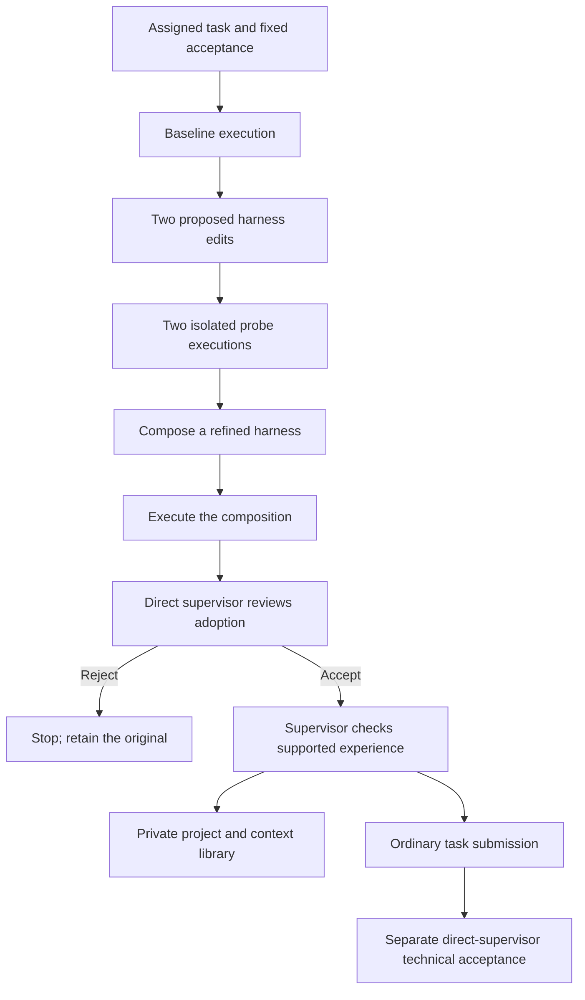

# Harness2 integration

Reviewed: 2026-10-23. Suite increment: 0.8.7. Integration status: real upstream core with a bounded native-host request adapter; deterministic local acceptance evidence only.

## Sources and the adopted mechanism

- [Google Research source](https://github.com/google-research/harness2/tree/1cfe254e8d25b15f37048c3730134686abe60335), package 0.1.0, pinned revision 1cfe254e8d25b15f37048c3730134686abe60335. The repository declares Apache-2.0 and says it is not an officially supported Google product.
- [Harness2 paper](https://arxiv.org/abs/2610.14224), submitted 2026-10-09: task-level Propose-Probe-Compose and persistent improvement experience around fixed model weights.
- [Upstream setup guide](https://github.com/google-research/harness2/blob/1cfe254e8d25b15f37048c3730134686abe60335/docs/SETUP.md): the complete benchmark runner targets Linux and uses separate model/executor setup.

The adapter calls the upstream core's run_parallel, reflect_adoption and Library.add APIs. It does not copy or reimplement the recursion algorithm, install a benchmark, launch the official executor, or require a Gemini subscription. The imported upstream package retains its Apache license; it is not bundled into the MIT suite or staged plugin runtime.

Hakengaisya adds its own host transport, call ceiling, fixed work contract and direct-supervisor adoption review. The ordinary employee evaluator continues to describe contextual ability. Harness improvement instead asks which working instructions helped this particular task, and which observed lessons may help later tasks. Model weights and evaluator skill scores do not change.

## Operating flow



The initial adapter supports one parallel recursion step, k=1. That means four work executions and three editing stages, plus one supervisor adoption request and one experience request: nine host requests on the successful initial path. Host requests are role/work sessions, not necessarily one provider API request each. The host must keep their own tool/model loops bounded. The ceiling counts unique issued requests conservatively, including pending requests. No extra classifier, permanent management agent, polling process or background model service is created.

This is disabled by default. A task-first brief opts in with an explicit, stable project scope:

```json
{
  "improvement": {
    "enabled": true,
    "scope": "project-alpha",
    "max_host_calls": 9
  }
}
```

The ceiling can be 1-12; a lower cap may stop before a full step. The iteration budget is fixed at one in this version. Unknown experiment spend/time remains unknown. Planner totals become null and base-dispatch estimates remain separately labelled. A hard planner budget or deadline produces needs-evidence because total probe/review costs are unpriced; do not remove that limit to make the plan appear feasible. Ordinary mode remains preferable for small coherent work unless an authorized improvement experiment has a concrete benefit.

## Optional setup

Normal Node workflow/evaluator use needs no Python. To enable the bridge, use Python 3.12 or 3.13 and install the exact optional source revision in a dedicated environment:

```powershell
python -m venv .local/harness2-venv
.local/harness2-venv/Scripts/python -m pip install "harness2 @ git+https://github.com/google-research/harness2.git@1cfe254e8d25b15f37048c3730134686abe60335"
```

On Linux, use the environment's bin/python path. Alternatively, pass --upstream with a clean checkout of the pinned revision; the bridge checks Git HEAD and tracked modifications. No authentication, Google Cloud setup, CLI/provider process, model credentials or unrestricted-sandbox configuration is performed by this integration. The Windows adapter normalizes the upstream tree's path separators and bypasses the Linux-specific full scheduler by calling the core directly.

## Host commands and response contract

Resolve HELPER and BRIDGE to absolute paths. Inside the plugin they are runtime/scripts/workflow.ts and runtime/packages/optimizer/harness2_bridge.py. The host fills the forms and handles native calls; users do not manually type each round.

```text
node HELPER harness2-job RUN.json PACKET_ID [STARTING_HARNESS.json]
python BRIDGE --job JOB.json --state .hakengaisya-learning [--upstream CHECKOUT]
node HELPER harness2-result RUN.json JOB.json REPORT.json
```

1. Use a current assigned pending packet with an explicit actual model_id and route. Generate the scoped job, save it unchanged, record start in the ordinary controller, then invoke the bridge. The optional starting-harness object can override systemprompt.md, LongTermMEMORY.md and tool_descriptions/tool_guidance.md with advisory text. It cannot override guardrails.
2. A needs-host result lists immutable request files and a response directory. Process only this status. The bridge exits between handoffs; it does not launch or choose a model for the host.
3. For each request, use its actor_context and current authority. Edits/probes belong to the assigned owner. Adoption and experience review belong to its direct supervisor. The native host may use existing permitted workers; the bridge does not authorize a new subagent, provider route or conversation message.
4. Every response echoes request_id, request_fingerprint and actor_context, with status:completed and observed cost_usd or null. Other statuses stop the improvement. Write it under responses with the request's filename. Rerun the same command; completed responses are reused without another host call.
5. For edit, return nonempty text and a full harness file map. For execute, return the unchanged model_id, every contracted output as id/reference/summary/text, nonempty evidence references/summaries and a readable trajectory. Probe artifacts must live in separate host-prepared workspaces with frozen inputs and the same logical write scope; do not run competing probes in the live project directory. The bridge supplies scoped task data, not an OS sandbox or automatic workspace provisioning.
6. For adoption-review, return accepted/rejected, a reason and inspected evidence. Rejection stops before retention. The host must compare baseline/candidate behavior against the fixed contract. Adoption never accepts the actual task.
7. For experience, the supervisor returns the upstream requested edits/experience blocks, or NO_ENTRY when no supported transferable lesson exists. Required lesson fields are cue, lesson and evidence; optional confidence states the observation's limits. Do not turn internal check results into public benchmarks or make broader model-gain claims.
8. A ready-for-submission report can be passed through harness2-result. This proposes an ordinary submit event only. Apply it through the controller; inspect real deliverables and perform normal technical review afterward. Rejected, blocked, stale, altered, wrong-model or self-approved records cannot be imported as accepted work.

The packaged [host reference](../plugins/hakengaisya/skills/company-workflow/references/harness2.md) includes a response form. Only three advisory Markdown components can change in this increment. Guardrails, task scope, acceptance, identity, budget, hierarchy and permissions stay fixed. Generated executable scripts, plugins, hooks, new subagents and live instruction-file edits are outside this adapter's editable surface.

## Local experience and recovery

State lives under the explicitly chosen .hakengaisya-learning directory: immutable request records, host responses, execution evidence, candidate harnesses, adoption decisions and the experience library. The library is separate from Codex memory and the hosted evaluator. Nothing is uploaded automatically. Keep it private; the release audit excludes it.

Learning profiles separate project scope, evidence kind, domain, task type, difficulty, skills, required tools, model, route and effort. Simulation never qualifies live guidance. Ephemeral worker IDs do not split the same model's learning profile. The next job snapshots approved same-profile experience as reference material; it does not silently overwrite a live system prompt or mutate an active organization. Earlier adopted harnesses and lessons are visible to the improver, not treated as higher-priority instructions.

Each complete job has an immutable input snapshot and deterministic session ID. Changed job inputs create a separate session. The host must freeze and fingerprint actual source artifacts too: stable reference text alone cannot detect changed file bytes or environment state. A completed report resumes without new calls or duplicate retention. Partial host failures and call ceilings stop; do not reinterpret a fallback or incomplete probe as success. A single-writer lock protects bridge state updates. Inspect an interrupted writer before removing a stale lock. A request/response file is host-declared evidence, not provider-authenticated identity or exactly-once execution.

Individual records and collected context snapshots are capped at 512 KiB, and context snapshots at 512 files. The bridge refuses oversized experience contexts rather than growing prompts without limit. Archiving/pruning is an explicit later operation; it does not delete old lessons automatically.

## Reproduce and assess the evidence

```powershell
npm run plugin:build
npm test
python -m unittest discover -s tests/harness2 -p test_*.py -v
npm run example:harness2 -- --python .local/harness2-venv/Scripts/python --output runs/harness2-demo
```

For a pinned source checkout, set HAKENGAISYA_HARNESS2_SOURCE for the Python integration tests, and use --upstream CHECKOUT for the example. The real-core checks cover a successful step, another task retrieving experience, a cached resume, supervisor rejection, wrong identities/models, failed work, pinned guardrails and the call ceiling. Node checks cover job construction, protected acceptance, unpriced overhead, stale results and ordinary submission semantics.

The example starts with a deliberately flawed positive-only ledger instruction. Deterministic host replies correct it to sum all signed amounts, the independent arithmetic changes from 105.25 to 85.15, and the ordinary controller accepts the final output after a separate check. Its simulation label, job, requests, responses, report and run are inspectable under the output directory. It invokes no model or provider and supplies no live employee ability evidence.

Actual automatic host invocation, model-produced edits, production task benefit, real cost/time savings, cross-client transport and the eight-component upstream edit surface remain unverified or outside this increment. These remain explicit roadmap work; the suite stays on 0.8.x.

The shared MCP tools are hakengaisya_optimizer_job and hakengaisya_optimizer_result. These short read-only handlers expose the same forms as harness2-job and harness2-result. Long worker execution stays outside the MCP request and run-file lock. Default promoted profiles, immutable profile-version selection, rollback and full lifecycle tools remain separate roadmap work. Retained lessons here are experiment reference material, not a promoted production default.
