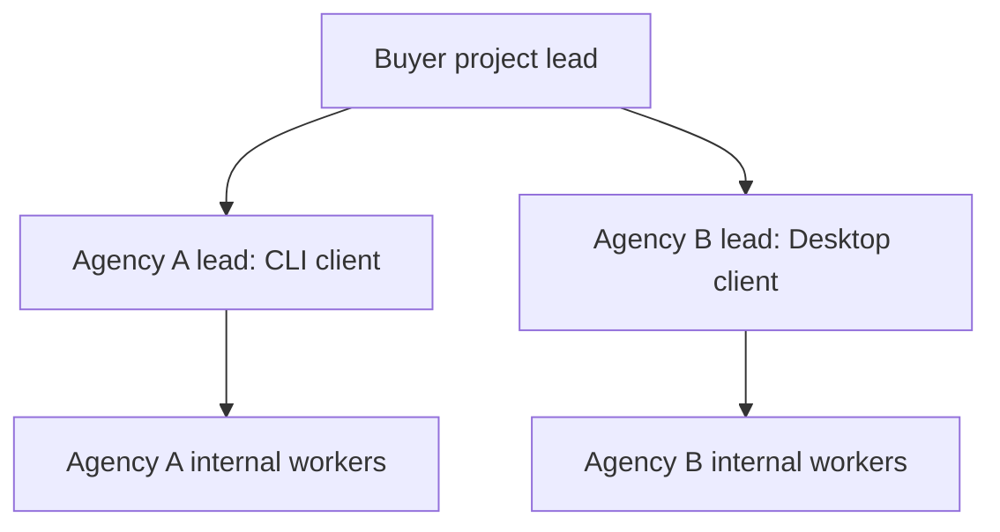

# Same-host coordination between agencies

Status: 0.8.2 contract and local-mailbox prototype. The buyer-to-supplier control flow is validated with synthetic records and a separate fixture process. Real Desktop, CLI, scheduler, GUI and router adapters are not connected by this release. The user selected same-host coordination as the first target; cross-machine transport is outside this increment.

## Operating structure

One buyer lead owns the overall project, dependency graph, interface contracts, budget decisions, integration and final acceptance. A supplier agency owns its internal workers, permitted models, tools and review hierarchy. The buyer assigns a bounded deliverable to the supplier lead rather than directly controlling the supplier's employees.



Supplier workers submit to their own lead. The supplier lead checks and integrates their results, then submits the contracted delivery to the buyer. Supplier-internal acceptance never grants buyer acceptance. The buyer can return a defective delivery to that supplier lead. Cross-agency interface changes go through the buyer so one agency cannot silently change another agency's obligations or task scope.

The buyer can be an existing Desktop or CLI host; it does not require a new always-running manager model. One buyer is the control-state writer. Supplier replies are data until the buyer validates and records them. The employee evaluator is separate: task packages, source, assets, internal transcripts and mailbox contents never become evaluator uploads.

## Connection modes

| Buyer / supplier surfaces | Candidate connection | Important condition |
| --- | --- | --- |
| Desktop / Desktop | Native task tool when provided; otherwise local inbox with explicit on-demand wake/check or GUI assistance | Verify the specific host capability, rather than assuming every Desktop exposes or lacks an invocation API |
| CLI / CLI | Configured CLI/SDK invocation or local inbox | Verify supported program entrypoint, structured inputs, exit status, result location, model/tool inventory and local capacity |
| Desktop / CLI | Buyer tool or explicitly configured process adapter | A process launch acknowledgment is not a delivery or acceptance |
| CLI / Desktop | Inbox plus a verified native-task, scheduled or GUI wake adapter | A keyboard action or message submission is not evidence that the Desktop finished work |
| Router inside one agency | Let that agency call permitted adequate models directly | A router route does not require an artificial supplier agency when the existing team can do the work |

Desktop and CLI are surfaces. Invocation/pull capability, authorization, model/tool availability and concurrency are separate properties. A CLI may also need an inbox; a Desktop may offer a native tool. Mixed connections use the same subcontract format. Transport preference never authorizes another client, account, credential use or external data destination.

## Current contract and commands

examples/federation/local-outsourcing.json describes one buyer and two supplier agencies. Clients declare id, surface, transport, capability_status and max_parallel. Optional models/tools inventories are declared metadata, not observed model identities or eligibility evidence. Credentials, executable command strings and account secrets are not accepted in client descriptors.

Each team names its registered lead and client. Each contract supplies a normal deliverable work item, required inputs/outputs, dependencies, exact workspace-relative writes and acceptance. compileFederation creates an ordinary buyer work brief using the existing hierarchical controller. Supplier leads report to the buyer in that brief; supplier-private internal hierarchies remain within their own client.

```text
node scripts/workflow.mjs federation-plan PROJECT.json
node scripts/workflow.mjs handoff RUN.json PROJECT.json PACKET_ID
node scripts/workflow.mjs receipt RUN.json REQUEST.json RECEIPT.json
```

federation-plan returns a draft brief and supplier bindings. It does not launch anything. Create a normal run from its brief, then assign each contract to the declared supplier lead with the buyer as its reviewer.

handoff emits a bounded envelope from a dependency-ready assigned packet, containing project/packet/attempt, stable request ID, content digest, shared workspace ID, buyer/supplier lead, scoped inputs/outputs/writes and checks. It omits the global company journal and unrelated history. The request ID is stable for the same contract attempt even when unrelated buyer revisions change. Reuse the stored immutable request after publishing; regenerating changed content under the same ID is a conflict requiring reconciliation, not another execution.

Before publishing a prepared request, the buyer records the normal start event and persists its authoritative run. Publishing must not bypass global capacity, writes or budget controls. A crash between start and publication needs reconciliation with the stored request/state; this prototype does not claim a distributed transaction across them.

receipt validates the envelope digest, supplier identity, current assignment, attempt and requested artifact IDs. A delivered result proposes a normal submit event and leaves the buyer packet in_review. It does not issue a review event. A blocked result proposes a blocker and preserves the buyer's correction authority. Returned commands, raw transcripts, arbitrary fields, stale attempts and supplier-declared buyer acceptance are rejected. Declared artifact checksums are not verified file contents; the buyer still inspects actual in-scope outputs and behavior.

## Local mailbox prototype

The library exports publishExchange and readExchange for a configured private project exchange root, normally outside the public source tree or under ignored .hakengaisya-exchange/. Lanes are inbox/TEAM/REQUEST.json, claims/TEAM/REQUEST.json and outbox/TEAM/REQUEST.json.

Records are bounded to 64 KiB, published as complete immutable files using a temporary file plus exclusive same-filesystem hard link. Identical publication is idempotent; conflicting content is preserved as an error. A supplier creates its claim record before work and executes only when created:true. Concurrent identical claims produce one successful creator. The fixture test runs this exchange from a separate ordinary Node process; that process is not an AI CLI or Desktop client.

There is no automatic lease expiry, claim deletion, timeout retry, takeover or cancellation. If an external client might still be working, the buyer must not blindly launch a duplicate paid job. A crashed supplier needs explicit reconciliation and, if appropriate, a new controller attempt. Exactly-once model execution is not claimed.

Path segments are constrained and directory links cannot redirect supplier files outside the configured root. These checks are not an OS security sandbox. File modes are requested; Windows also relies on the private directory's ACLs. SHA-256 detects content changes but does not authenticate a process, model or AI author. Same-host participants must be trusted and separately configured by the owner. Real adapters need host-enforced access, scoped artifacts, binding/claim checks and a durable receipt/reconciliation policy.

## Required follow-up before real-client readiness

- Connect and verify a bounded CLI adapter with allowlisted executable/argument arrays, correct working directory, actual model/tool access, exit/status capture, cancellation behavior and per-client capacity.
- Connect a Desktop adapter using the capabilities actually provided by the selected host. A scheduled/UI adapter only wakes/checks approved work; it does not run another model merely to poll empty inboxes.
- Bind the shared workspace or use scoped artifacts/worktrees. Declared writes do not enforce filesystem isolation or prove that a receiver has the inputs.
- Preserve one buyer writer, stable IDs, supplier-local limits, global limits, budget accounting and uncertain-execution stops across restart/recovery.
- Test Desktop/Desktop, CLI/CLI and both mixed buyer/supplier directions using actual supported clients in 0.9. A transport simulation does not satisfy that matrix.

Existing native subagents remain the ordinary within-host path. Cross-client outsourcing is appropriate for a real capability, model access or capacity gap, with an explicit registered recipient. It does not replace native agents by launching another CLI merely to imitate the same worker.

## Protocol references and limits

[A2A's specification](https://a2a-protocol.org/dev/specification/) separates capability descriptions, task state and artifacts, and includes asynchronous progress/update mechanisms. The proposed local client registry and receipt states borrow these distinctions. This prototype does not implement or claim A2A conformance.

[The MCP Tasks extension overview](https://tasks.extensions.modelcontextprotocol.io/) describes capability negotiation and polling for long-running task handles. It informs adapter discovery and asynchronous status handling; ordinary MCP tool availability alone does not prove task/wake support. No MCP Tasks extension implementation is claimed here. Sources were reviewed on 2026-10-19.
