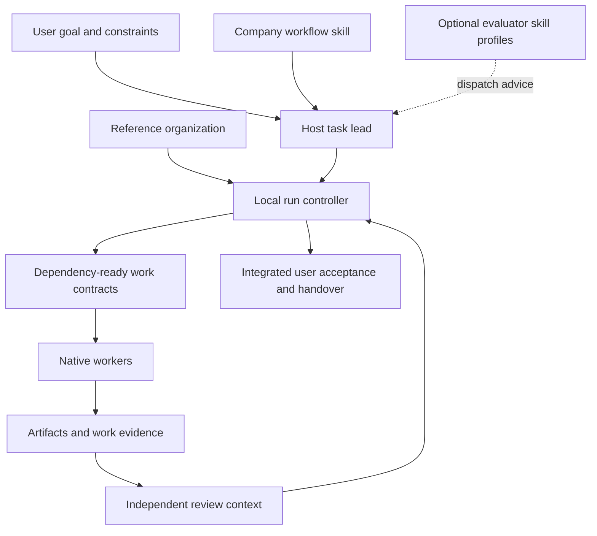
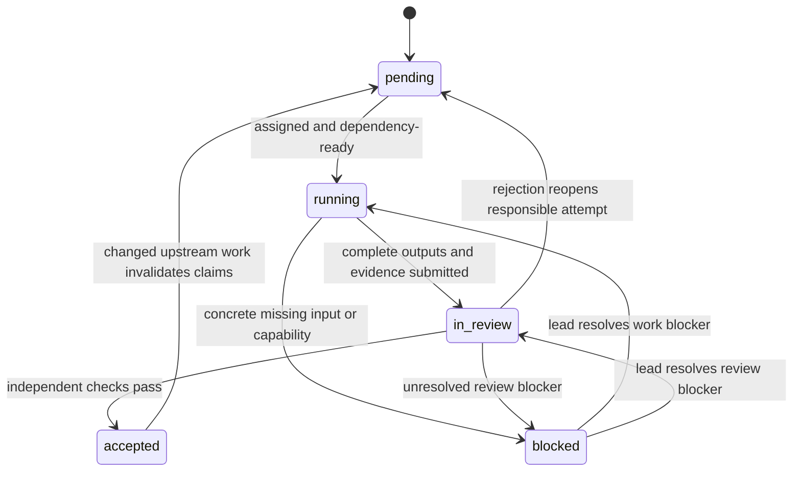

# Company workflow architecture

Version0.7 makes [direct-supervisor authority and upward acceptance](../plugins/hakengaisya/skills/company-workflow/references/supervision.md) structural. Work dependencies govern readiness; rooted reporting lines govern assignment, acceptance and return for correction. Each lead submits its own real delivery to its parent, with final acceptance at the root. Task size controls the necessary levels, while cost/time optimization preserves this authority model. The earlier architecture below remains historical background.

Version0.5 starts with [lightweight intake triage](../plugins/hakengaisya/skills/company-workflow/references/intake-triage.md), then [task-first deliverables and cost/time routing](task-first-planning.md). Triage routes to a worker or the existing host and creates no management layer. The reference organization and historical trial below remain background. Full-template execution is explicitly requested rehearsal; ordinary runs contain only their work_items.

## Native host and local control

Hakengaisya has four layers:

1. The company skill selects an appropriate reference structure and directs the host AI's decisions.
2. The reference organization defines responsibilities, delegation relationships, collaboration, artifact dependencies, and review gates.
3. The local run controller records assignments, evidence references, attempts, review decisions, and downstream invalidation.
4. The execution host performs work, launches native subagents when useful and authorized, provides tool permissions, and checks actual evidence.

The evaluator is a separate optional capability source. It does not determine whether an implementation passed its required tests. Company run files are local and are never evaluation uploads.

## Select structure by task

Direct work needs no company state. Compact work keeps reference responsibilities but limits active work and reuses contexts across compatible roles. Company work permits independent streams with bounded concurrency. This is task-sensitive activation of known templates, not dynamic organizational generation.

Software delivery and technical product discovery use different templates. Product discovery cannot manufacture interviews or turn a simulated user into real evidence. Software verification cannot convert a confident completion message into a behavioral test result.

Support roles are capabilities. A platform packet can document readiness of an existing environment without starting a platform department. A large implementation packet may use smaller host-managed work items with explicit artifact ownership. The parent owner integrates them; the controller currently persists only the template-level packets.

## Packet lifecycle

Rejection may reopen an earlier responsible packet and every descendant instead of just the current packet. An unchanged scope or design result stays accepted when an implementation-only correction does not affect it. Old attempts remain in history. Revision and attempt checks reject late worker results.

## Observable invariants

- The lead updates persisted state; native workers return results instead of racing to write the run file.
- Only accepted dependencies unlock work. Unreviewed output is not an accepted artifact.
- Owner and contributor contexts differ from the gate reviewer context. Renaming roles does not create independence.
- Independent verification is outside implementation producers; technical product evaluation is outside prototype producers.
- Windows write scopes are compared without case distinctions and directory overlap prevents concurrent starts. They are declarations, not filesystem enforcement.
- Each required output and each gate check must be present. An unverified check cannot pass.
- Final handover checks every user acceptance criterion in addition to the template's generic gate.
- Attempt, dispatch, and concurrency limits prevent unbounded re-dispatch. They do not represent money or model capability.
- A single-writer lock and revision check prevent silent concurrent snapshot replacement. The lock records the writer's pid and start time; a crash may leave a lock requiring inspection, and the helper does not guess that it is stale.
- An event batch is applied in order inside one lock and persisted only if every event is valid. Journal entries carry the controller clock, which measures recording and waiting time, not model execution.
- The CLI helper and the plugin's MCP tools share one command table, so a host using either transport meets the same checks.

## Current proof and limits

Executable tests cover reference selection, scheduling, role/context separation, write conflicts, rejection history, invalidation, stale updates, retry limits, blockers, final acceptance, and CLI persistence. Their worker identities and evidence are synthetic. They establish controller behavior, not the quality of a real delivery.

The skill is packaged with implicit invocation enabled. Discoverability does not establish that a fresh installed host has loaded it or will use it on every task. The prototype has no automatic spawn hook, separate external model invocation, idle model loop, or monetary budget manager. Native model availability, model selection, evidence inspection, tool access, and external actions remain host responsibilities.

On 2026-10-10, a bounded native Codex subagent checked direct comment correction, compact parser repair, technical product exploration, and a proposed same-context reviewer assignment. It ran the standalone helper from another working directory: selection, run creation, next-action readback, accepted assignment persistence, and rejection without state mutation succeeded. All test identities and evidence were synthetic. Its finding about exploration without user research led to the explicit hypothesis-inventory rule; this was a skill usability check, not a delivered software or product task.

Build the self-contained plugin with `npm run plugin:build`. Run `npm test` and `npm run inspect`. Read the skill's [operating contract](../plugins/hakengaisya/skills/company-workflow/references/operating-contract.md) and [run forms](../plugins/hakengaisya/skills/company-workflow/references/run-commands.md) for actual usage.
